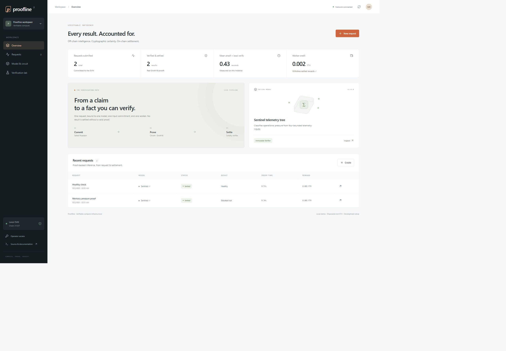
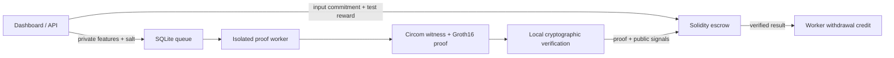

# Proofline

**Verifiable inference, from a private input commitment to an on-chain reward.**

[](https://github.com/Mudit-R/proofline/actions/workflows/ci.yml)

Proofline is an end-to-end computational-integrity workbench: a worker evaluates a trained telemetry classifier, generates a real Groth16 zero-knowledge proof, and submits it to a Solidity verifier. An escrow contract checks the request context before accepting the result and crediting the worker. The dashboard displays actual job states, proof timing, EVM receipts, rewards, and adversarial checks.



It demonstrates how an application can accept outsourced computation without taking the worker's word for the answer. This release uses a local EVM with disposable funds. It is not a public-chain deployment, an audited payment protocol, or a Ritual integration.

## Run the whole application

Requires Docker Desktop with Linux containers (or Docker on Linux), approximately 2 GB available memory, and a free port 15190.

```sh
docker compose up --build -d
docker compose logs -f
```

Open **http://127.0.0.1:15190** after startup completes. On first start the container compiles the circuit, creates and verifies a development trusted setup, deploys the real verifier and escrow to its local EVM, and starts the API. Subsequent starts reuse the persistent chain, proof setup, and SQLite jobs.

1. Choose **New request** and a preset, or sample actual server telemetry.
2. Commit the request. Its private feature values and salt go to the proving operator; the EVM stores a Poseidon commitment.
3. Watch the worker generate and locally verify the proof, then verify it through the Solidity contract and settle the reward.
4. Download the proof bundle, inspect gas and transaction hashes, or withdraw credited test funds.
5. Open **Verification lab** to inspect actual rejected static-call attacks.

Keep **both** volumes (`proofline-state` and `proofline-artifacts`) for continuity. A fresh setup produces a new verification key and must be paired with a fresh deployment.

## Develop locally

Node 24 or later is required for `node:sqlite`. Linux is the recommended circuit-build environment. On Windows, `npm run setup` uses Docker just for the Circom compilation step; the application and proof generation run natively afterward.

```sh
npm ci
npm run setup
npm run build
npm start
```

Use `npm run dev` in a second terminal for frontend development (Vite proxies the API to port 15190). `npm test` generates genuine proofs and verifies them through an EVM; it does not use a mock verifier. `node scripts/verify-bundle.mjs path/to/bundle.json` verifies a downloaded bundle independently. Always establish the provenance of its verification key as well: a proof and an attacker-chosen key alone do not establish the intended statement.

## The proved statement

The circuit constrains four feature values to integers from 0 through 100, applies the trained tree's fixed integer thresholds, and publishes:

| Index | Public signal                                                      |
| ----- | ------------------------------------------------------------------ |
| 0     | Risk class, 0 or 1                                                 |
| 1     | Poseidon commitment to the four features and a random 248-bit salt |
| 2     | Poseidon commitment to the six context fields below                |
| 3–8   | Chain ID, consumer address, job ID, requester, worker, model ID    |

Context fields participate in the circuit's Poseidon computation; they are not unused public declarations. The model ID is constrained to the generated constant, and the verification key binds the tree's actual thresholds. The consumer contract checks the public signal values against its stored request, current chain, its own address, immutable model ID, and submitting worker. Changing the prediction also invalidates the pairing proof.



The model is **Sentinel**, a depth-three decision tree trained on deterministic **synthetic** operational telemetry. Training uses 2,000 examples and evaluation uses 400 separate examples; the model card records the seed, rules and measured held-out accuracy. It is an inspectable demonstration model, not a validated production anomaly detector. The circuit proves its computation, not the truth of the submitted telemetry or the quality of its predictions. Inputs are hidden from on-chain observers, not from the operator who proves them.

## Blockchain behavior

- Native-token escrow is deposited when requesting work.
- The deadline and immutable model identity are recorded on-chain.
- Genuine proofs can settle a pending request once, before expiry.
- Rewards accrue to a worker address bound into the proof. Copying the proof from another worker cannot redirect its credit.
- Expired requests can be refunded only by their requester.
- Pull withdrawals clear credit before transferring value.
- The demo persists its EVM state; all addresses and transaction hashes shown are local-chain values.

Each model version currently has its own immutable verifier and consumer deployment. Model upgrades, permissionless worker discovery, and network consensus are outside this release.

## Evidence and tests

The **29-test** protocol and API suite covers genuine healthy and elevated-risk proofs, invalid feature ranges, model substitution, changed outputs and commitments, wrong domains and requesters, front-running, malformed curve points, duplicate settlement, expiry, refunds, withdrawals, authentication, transaction receipts and input privacy. See [executed validation](docs/VALIDATION.md). The checked-in [sample proof bundle](docs/evidence/sample-proof.json) includes the verification key and measured local settlement data. Reproduce it with:

```sh
npm run setup
npm test
node scripts/verify-bundle.mjs
```

The example bundle is from a local chain. Do not interpret its transaction hash or gas result as a public-network receipt or throughput claim. The app's live attack lab uses read-only EVM simulations; the successful settlement itself is a mined local transaction.

## Deployment and security

The Docker image serves the production UI and API on one port, provides a health endpoint, runs as an unprivileged user, serializes proof work in a child process, bounds the proof queue, and persists state. See [deployment](docs/DEPLOYMENT.md), [threat model](docs/SECURITY.md), and [architecture](docs/ARCHITECTURE.md) before exposing an instance.

The default setup is a **single-machine development ceremony**. A trusted setup verified by tooling is not the same as a production multi-party ceremony with independent contributions. No security audit, production trust, public testnet integration, or Ritual integration is claimed.

## Source map

| Directory    | Responsibility                                                  |
| ------------ | --------------------------------------------------------------- |
| `circuits/`  | Generated, inspectable inference constraints                    |
| `contracts/` | Job lifecycle, proof verification, escrow and withdrawals       |
| `models/`    | Frozen tree, provenance and held-out evaluation                 |
| `server/`    | API, SQLite queue, process worker, cryptography and EVM adapter |
| `web/`       | React dashboard, requests, model inspector and attack lab       |
| `scripts/`   | Training, setup, independent verification and startup           |
| `tests/`     | Real proof and chain integration tests                          |

The cryptographic implementation uses [snarkjs](https://github.com/iden3/snarkjs) and [circomlib](https://github.com/iden3/circomlib); the local EVM uses Ganache. Proofline does not implement a new proof system. Source licensing is GPL-3.0; see `LICENSE` and [third-party notices](docs/THIRD_PARTY.md).
